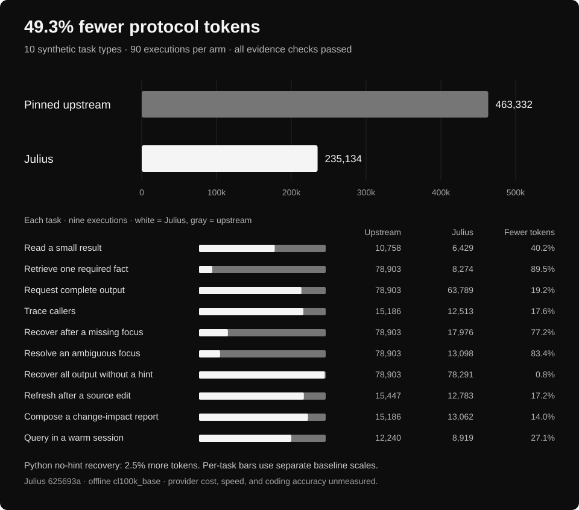

<p align="center">
  
</p>

<h1 align="center">Julius</h1>

<p align="center">
  <strong>"That's 50,000 tokens of context. Do you think tokens grow on trees?"</strong><br>
  Local code intelligence and recoverable context for coding agents.
</p>

<p align="center">
  <a href="#install">Install</a> ·
  <a href="#how-it-works">How it works</a> ·
  <a href="#benchmarks">Benchmarks</a> ·
  <a href="#documentation">Documentation</a>
</p>

Your agent needs to find a function, follow its callers, or locate a failure in a
long log. Julius builds a local repository graph and returns evidence within a
context budget. Omitted output stays on disk, ready to recover when the agent
needs it.

Structural indexing and context recovery run locally, without a model key.
After MCP setup, keep asking normal coding questions. The agent discovers and
calls Julius through two tools.

<!-- benchmark:summary:start -->
**49.3% fewer protocol tokens** in a [recorded offline MCP benchmark](#benchmarks).
10 task types, three languages, 90 executions per variant. Every declared evidence check passed.
<!-- benchmark:summary:end -->

## Install

Requires **Node.js 20+** and npm.

```sh
npm install -g @ruverd/julius
julius install --dry-run
julius install
```

To update an existing installation:

```sh
npm install -g @ruverd/julius@latest
julius --version
```

Restart or reconnect the client's MCP session after updating. Run `julius install`
again if the Node executable or installed package path changes. To select an
exact version, use `npm install -g @ruverd/julius@0.24.3`.

### Install from source

```sh
git clone https://github.com/ruverd/julius.git
cd julius
npm ci
npm run build
npm pack --pack-destination .
npm install -g ./ruverd-julius-0.24.3.tgz
julius install --dry-run
julius install
```

Setup detects Claude Code, Cursor, Codex, and the native xAI Grok CLI. To select
hosts explicitly, use `julius install --hosts claude,cursor,codex,grok`.
Restart or reconnect the client's MCP session after setup.

Then open a repository in your coding client and ask:

```text
What calls handleRequest, and what could this change affect?
Find the code near this failure: "expected 403 received 200".
```

The host must start MCP in the repository's working directory. Julius indexes
that repository on demand. Tool selection and permissions belong to the host
agent; configuration and stdio tests do not establish live client compatibility.

Keep the installed Node executable and package path in place. If either moves,
run setup again. To undo global setup, run `julius uninstall --global`.
See [installation and migration](docs/installation.md) for rollback, ownership
conflicts, and repository-specific setup with `julius init`.

## How it works

Julius gives agents a structural view of the code and control over how much
evidence enters the conversation.

| When the agent needs to… | Julius provides… |
| --- | --- |
| Find code | Ranked search, file signatures, and source locations |
| Understand dependencies | Call tracing, reference edges, and repository maps |
| Investigate a change or failure | Experimental change-impact and literal failure-localization reports |
| Read a large result | Bounded previews, literal focus, or explicit complete delivery |
| Recover omitted evidence | Local SHA-256 handles, byte ranges, and exact-text search |
| Keep repository knowledge | Shared learnings under `.julius/learnings/` |

The default MCP server advertises `julius_discover` and `julius_call`. The agent
discovers an operation's schema, invokes it, and retrieves more evidence as needed.
Results default to a 1,200-token text budget using the offline `cl100k_base`
encoding. Explicit complete delivery without a budget returns all captured bytes.

Graph evidence has limits. Dynamic calls, ignored files, and unsupported syntax
can be missing. A dependency is a candidate for investigation, not proof of a
breakage. See [investigations and limitations](docs/investigations.md).

## Benchmarks

<!-- benchmark:results:start -->
**49.3% fewer protocol tokens**, with all declared evidence checks passing in both variants.
Julius uses **228,198 fewer tokens** across the recorded task mix.

| Metric | Pinned upstream | Julius | Change |
| --- | ---: | ---: | ---: |
| Total protocol tokens | 463,332 | 235,134 | **49.3% fewer** |
| Mean protocol tokens per execution | 5,148 | 2,613 | 49.3% fewer |
| Executions passing evidence checks | 90/90 | 90/90 | All passed |



**What ran:** ten synthetic evidence tasks in TypeScript, Python, and Go, with
three repetitions per task and language. Counts include MCP initialization,
schema discovery, requests, responses, and every recovery call. Julius follows
the recorded selective/complete policy. Both variants face the same evidence checks.

<details>
<summary>All ten tasks: protocol tokens across nine executions each</summary>

| Task | Pinned upstream | Julius | Fewer tokens |
| --- | ---: | ---: | ---: |
| Read a small result | 10,758 | 6,429 | 40.2% |
| Retrieve one required fact | 78,903 | 8,274 | 89.5% |
| Request complete output | 78,903 | 63,789 | 19.2% |
| Trace callers | 15,186 | 12,513 | 17.6% |
| Recover after a missing focus | 78,903 | 17,976 | 77.2% |
| Resolve an ambiguous focus | 78,903 | 13,098 | 83.4% |
| Recover all output without a hint | 78,903 | 78,291 | 0.8% |
| Refresh after a source edit | 15,447 | 12,783 | 17.2% |
| Compose a change-impact report | 15,186 | 13,062 | 14.0% |
| Query in a warm session | 12,240 | 8,919 | 27.1% |
| **Total** | **463,332** | **235,134** | **49.3%** |

</details>

**Where the gain shrinks:** recovering all output without a hint saves only
0.8% across languages. Python uses **2.5% more** tokens in that task.
Complete-byte recovery verifies the captured object's digest. Composed impact
checks verify required caller identities. These checks do not measure coding accuracy.

**Measurement scope:** offline `cl100k_base` counts of JSON-RPC NDJSON traffic.
Provider usage, dollar cost, agent speed, and real issue resolution remain unmeasured.
The scripted policy does not establish which tools a model chooses autonomously.

Measured Julius source: [`625693a`](https://github.com/ruverd/julius/commit/625693a046ebc011d2c29ec09e0a03385a1b2a46),
prepared for `0.24.1`, against the [pinned upstream executable](PROVENANCE.md).
Read the [method and reproduction steps](docs/strategy/recovery-impact-comparison.md),
[raw results](docs/strategy/recovery-impact-comparison.json), or
[protocol traces](docs/strategy/recovery-impact-comparison.traces.json.gz).
The [earlier comparison](docs/strategy/performance-comparison.md) remains available.

Regenerate the summary, tables, and chart with `node scripts/render-readme-benchmark.mjs`.
Verify them with `node scripts/render-readme-benchmark.mjs --check`.
<!-- benchmark:results:end -->

## Local navigation

The CLI also works directly, without an MCP client or a model key:

```sh
julius build /path/to/repo
julius ask "Where is authentication checked?" --source /path/to/repo
julius map /path/to/repo
julius callers handleRequest /path/to/repo
julius skeleton src/index.ts /path/to/repo
julius build --check /path/to/repo
```

Graph data lives in `.julius/cache/`, shared learnings in `.julius/learnings/`,
and machine state in `~/.julius`. `--deep` explicitly enables model-assisted
analysis. Run `julius --help` for the command list.

`julius grep` accepts JavaScript regular expressions, including lookbehind and
backreferences. Use `--fixed` for literal text. Compilation and matching each file
have a 1,000 ms limit; exceeding it aborts the search with an error.

### Recoverable context economy

Keep noisy command output out of the conversation until you need it:

```sh
julius run --budget 512 -- npm test
julius capture --file build.log --budget 512
julius read sha256:<digest> --search 'error' --budget 512
julius economy stats
```

`run` executes its command once and preserves its exit status or signal. Handles
recover captured bytes exactly, up to the 8 MiB capture ceiling. Follow-up reads
add to delivery cost, so savings can become negative. Local payload counts are
not provider measurements. See [context economy](docs/context-economy.md) for
limits, retention, accounting, and the exported API.

### Public API

```ts
import { Julius } from '@ruverd/julius';

const engine = new Julius();
await engine.graph('/path/to/repo');
const drift = engine.check('/path/to/repo');
```

## Documentation

| Guide | What it covers |
| --- | --- |
| [Installation and migration](docs/installation.md) | Host setup, rollback, ownership, and migration |
| [Investigations](docs/investigations.md) | Change impact, failure localization, freshness, and coverage |
| [Compact MCP](docs/compact-mcp.md) | Discovery, budgets, delivery controls, and recovery |
| [Context economy](docs/context-economy.md) | Capture, command output, storage, accounting, and API |
| [Executable comparison](docs/strategy/performance-comparison.md) | Recorded benchmark results and counterexamples |
| [Fixture benchmark](docs/economy-benchmark.md) | Offline payload accounting and exact-byte recovery |
| [Research notes](docs/research.md) | Local context techniques and research boundaries |
| [External services](TELEMETRY.md) | Optional configuration and network behavior |

There is no default Julius cloud service, telemetry collector, or automatic npm
check. Optional external services require explicit configuration. A command you
explicitly run through Julius can access the network.

## Development

```sh
npm ci
npm run build
npm test
node dist/bin/julius.js --help
```

Run `npm run benchmark:economy` after building for the separate offline fixture
experiment. See [releasing](docs/releasing.md) for versioning, release checks,
npm trusted publishing and recovery. Julius release notes live in
[CHANGELOG.md](CHANGELOG.md).

## License and provenance

Julius is an independent TypeScript fork of Trail-Code, distributed under the
[MIT license](LICENSE). Upstream copyright and credits are preserved. See
[source provenance](PROVENANCE.md) for the pinned source, fork history, and the
archived earlier Julius product.
