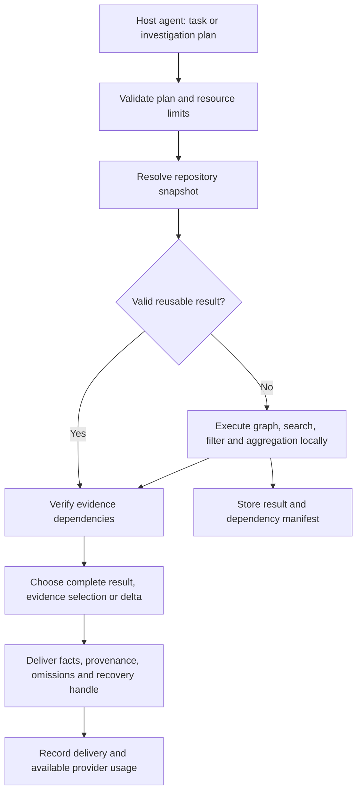

# Julius: from bounded output to reusable investigations

Status: proposed research and architecture, not implemented capabilities.
Date: 2026-10-21. Companion: [delivery plan](delivery-plan.md).

## Decision

Build a local investigation runtime on top of the inherited code graph. Move intermediate tool work out of model conversation, reuse results only while their evidence remains valid, and select how much evidence to deliver according to the task. The intended product advantage is fewer paid reasoning and tool round trips per correctly completed task, not merely shorter logs.

This is an engineering research hypothesis. Combining programmatic retrieval, incremental computation, provenance and budget selection is not a demonstrated new scientific technique. Establish product differentiation through reproducible comparisons; do not label it revolutionary before those results exist.

Keep the default product TypeScript/Node, local and usable without a GPU, container runtime or additional model subscription. Explore model-internal techniques separately, without making the CLI depend on them.

## Evidence from the supplied projects

Primary repository documentation was revisited on 2026-10-21. These are upstream descriptions, not independently reproduced results. Earlier implementation inspection and pinned blob identities are recorded in [research notes](../research.md).

| Source | Mechanism and relevant evidence | Julius decision |
| --- | --- | --- |
| [minRLM](https://github.com/avilum/minrlm) | Model-generated programs inspect external context through an execution loop. Its benchmark reports token reductions but also a model configuration with higher financial cost and another with lower accuracy. | Adopt local processing before delivery. Count planning, retries and output tokens. Start with constrained declarative plans instead of arbitrary Python. |
| [codemode-lite](https://github.com/redhat-et/codemode-lite) | A Python execution interface can compose MCP calls inside Podman or Pyodide; discovery and schema helpers reduce eager exposure. | Adopt composition and selected-schema discovery. Keep first implementation limited to local, read-only operations; arbitrary execution would introduce an independent isolation project. |
| [RecursiveMAS](https://github.com/RecursiveMAS/RecursiveMAS) | Released systems use role-specific models and trained inner/outer RecursiveLink modules; reproduction requires matching training configurations. | Research track only. Sharing evidence references between commercial API agents is useful, but is not latent communication or an implementation of RecursiveMAS. |
| [ReCache](https://github.com/EIT-NLP/ReCache) | Resource-level KV reuse uses modified attention/routing and pruning on Qwen models. Its reported invocation score also changes. | Optional self-hosted inference experiment. KV memory savings cannot be substituted for billed API token savings. |
| [EfficientAgent](https://github.com/KunmingSHAO/efficientagent_release) | Admission and reuse policies operate through vLLM/LMCache, with separate replay and GPU serving requirements. | Borrow the question of which reusable work deserves retention. Actual KV integration belongs to the self-hosted track. |

The first two projects directly inform the installable product. The other three change the inference system. Their reported percentages must never be combined or transferred to Julius.

## Current baseline and missing mechanisms

Existing: structural graph inherited from Trail; two-tool compact MCP; local content-addressed output storage; bounded previews; exact captured-byte recovery; offline token accounting. See [benchmark limitations](../economy-benchmark.md).

Missing: composable investigation execution, dependency-aware reuse, receiver-aware delivery, adaptive routing, real host adoption measurements, and matched coding-task evaluation. A hash-based object store does not establish semantic reuse. A previous tool response does not prove that a model still has it after context compaction.

## Alternatives considered

| Option | Potential | Main weakness | Decision |
| --- | --- | --- | --- |
| More aggressive text truncation | Cheap improvement for large output | Hides relevant information; recovery can erase savings | Retain as fallback, not central strategy |
| LLM summaries or a local small model | May select semantic evidence | Extra tokens/latency, hallucinations, installation burden | Optional later experiment against deterministic selectors |
| Transparent API proxy | Could observe broader traffic | Host compatibility, credentials, message integrity and cache behavior | Defer; first measure gaps with explicit CLI/MCP paths |
| Local investigation plans | Remove intermediate model round trips | Plan errors, incomplete graph, operation limits | First architectural experiment |
| Dependency-aware reusable results | Avoid repeated investigation | Invalidation and scope errors | Second experiment, after reproducible plans |
| Own inference and latent agents | Access to model-internal optimizations | GPUs, training, provider independence lost | Separate research track |

## Proposed architecture



### 1. Investigation plans

Extend `julius_call` with a discoverable `investigation.execute` operation rather than adding a large permanently advertised interface. A versioned JSON plan contains a bounded DAG of allowlisted operations: resolve symbol, callers, references, source ranges, literal search, filter, join, group, sort, distinct and select. Inputs refer to previous results by ID. Only selected final results enter the model conversation.

The host model creates the plan, so its generation cost counts. Named recipes for common investigations can avoid repeated plan generation. Start with impact analysis and failure localization, not unconstrained natural-language execution. Graph uncertainty must propagate: unresolved dynamic edges cannot become claims that no callers exist.

Proposed example, not an existing API:

```json
{
  "version": 1,
  "recipe": "change-impact",
  "inputs": { "paths": ["src/auth.ts"] },
  "deliver": { "fields": ["affectedSymbols", "evidence", "unknowns"], "budget": 1200 }
}
```

Execution must enforce total steps, fan-out, traversed nodes, bytes, memory and wall time. Initial experimental limits: 32 steps, 10,000 traversed nodes, 8 MiB intermediate data and 5 seconds of execution after indexing. These are tuning inputs, not performance claims. No arbitrary evaluation, shell, network or external side effects in this operation. Existing explicit CLI command capture remains a separate path.

### 2. Reusable evidence with dependency manifests

Store deterministic findings with source spans and a reproducible plan. Each record includes repository/worktree identity, normalized plan and inputs, engine/parser versions, source hashes, graph revision, dependencies, completeness, output handles and creation metadata. Separate extracted facts from agent-written hypotheses. A hypothesis must never become a verified fact merely because it was stored.

Begin conservatively: invalidate on any relevant repository snapshot change. Then refine dependency tracking to individual files and graph queries. Search and absence claims depend on a search scope, not only matched files: adding a new caller must invalidate a previous caller list even if old files did not change. Configuration, lockfiles, generated code, deleted paths, renames, dirty worktrees and parser changes must participate where relevant.

Fingerprint inputs before and after execution. If the snapshot changes during the operation, return stale/incomplete status or retry only a pure local operation within a bound. Never rerun an external command for measurement or silently reuse its result as current. Test output is historical evidence unless a separately defined execution context proves validity.

### 3. Receiver-aware delivery and handoff

Share an evidence ID plus a compact useful summary between agents instead of forwarding whole transcripts. Every receiver still needs enough content to act; an opaque hash communicates no semantics.

Use repository, session and context-epoch scope. Delta-only delivery requires an explicit receiver-provided base ID and valid context epoch. After compaction, restart, a new agent, or absent acknowledgment, send a self-contained result. Generic MCP hosts may not supply context epochs: disable implicit suppression there. Do not interpret successful transport as proof of retained model context.

### 4. Adaptive evidence selection

Choose among complete small output, selected evidence and supported deltas. Estimate total delivery plus likely recovery cost; account separately for model planning and provider prompt-cache effects when observable. Initial policy is deterministic and inspectable. Do not claim optimality or use a learned policy before collecting held-out traces.

Prefer complete output when small, when the task needs every byte, or after repeated recovery. A hard caller budget remains binding: if completeness cannot fit, return explicit incompleteness and recovery options. Do not silently increase budgets. Explore selectors combining task symbols, graph distance, diagnostics and diversity, rather than only head/tail truncation.

### 5. Integration and measurement

Keep CLI/MCP as supported boundaries. Measure whether agents choose the operations and whether they fall back to raw reads. Installation alone does not guarantee savings. Each host gets a capability record: tool discovery, session identity, output interception if available, usage access and observed adoption. Unsupported capabilities stay unknown rather than inferred.

Default execution remains local. API trials require explicit provider configuration and spending limits. Usage records separate uncached input, cached input, output, reasoning tokens when available, retries, latency and price version. Unknown fields remain null. Do not double-count provider fields where reasoning is a subset of output.

## Product experience

Retain one package and `julius install`, with reversible host configuration. New operations become available through existing compact discovery. No default containers, GPUs, model downloads or telemetry. A proposed `julius doctor` should explain whether the active host can use the optimization and what remains unobservable; it is not currently promised as implemented.

Local storage needs a disk quota and explicit retention policy before shared evidence grows unbounded. Pin evidence referenced by active runs; eviction must return an explicit expired handle, never substitute other content. Cross-project sharing is off by default. Repository text and tool output remain untrusted data, never executable plan instructions.

## Research hypotheses and falsification

| Hypothesis | Controlled comparison | Reject or revise when |
| --- | --- | --- |
| Local composition removes expensive round trips | Same operation plan, separate calls versus local DAG | Planning and corrections erase savings or task success falls |
| Validated reuse beats repeating investigations | Cold versus warm runs, then targeted mutations | Stale conclusions survive, validation dominates, or reuse is rare |
| Adaptive delivery beats fixed preview budgets | Same tasks and evidence under fixed versus adaptive policy | Total tokens rise or recovery/accuracy worsens |
| Scoped handoffs reduce repeated work | Same team task with transcripts versus evidence bundles | Receiver must reconstruct missing context at equal or higher cost |
| Combined product beats Trail | Pinned actual Trail versus candidate, matched host/model/tasks | Savings depend on failures, changed task quality or favorable fixtures |

Targets and a reproducible evaluation protocol are in the delivery plan. No savings percentage in this study is an achieved product claim.

## What would justify a stronger innovation claim?

A measured combination of local composition, correct incremental invalidation and receiver-aware evidence delivery could distinguish Julius as a product. The strongest research question is whether a dependency-tracked investigation can be reused and delivered selectively while preserving coding success under code changes and context resets.

Novelty remains unproven. Before a publication or scientific novelty claim, expand the related-work review to incremental build/query systems, retrieval agents, execution-based MCP, semantic caches and shared agent memory. The five supplied repositories are useful starting points, not an exhaustive prior-art search.
